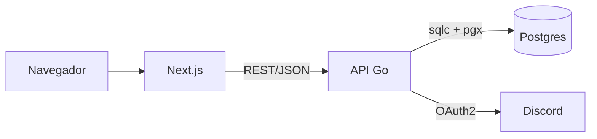
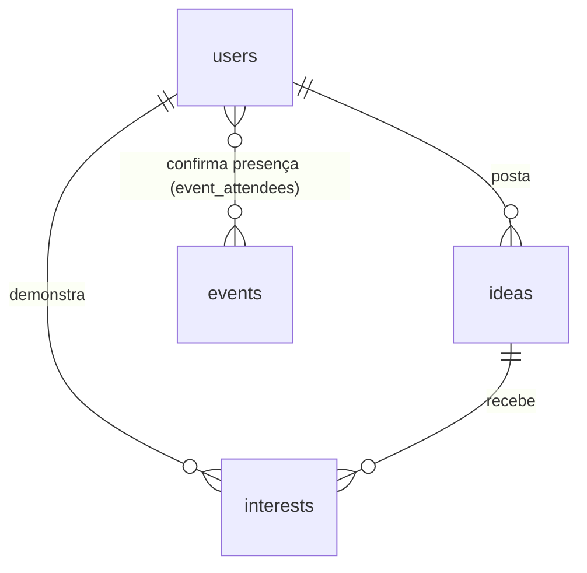

# PRD — Plataforma de Projetos de TI (FAESA)

8 de outubro de 2026 · Davi de Souza

Documento de requisitos do produto, focado no MVP. Enxuto no texto, completo no conteúdo — serve para dar contexto pleno do projeto a qualquer pessoa ou IA que for implementar.

## Visão geral

**O que é:** uma plataforma web para alunos de TI da FAESA (Ciência da Computação, Engenharia e ADS) acharem parceiros de projeto e terem mais oportunidades de botar a mão na massa juntos.

**Problema:** alunos querem fazer mais projetos e eventos da área, mas falta gente para montar time, falta comunicação entre quem tem ideia e quem quer participar, falta um meio onde isso aconteça, e há poucas oportunidades de mão na massa (o hackathon acontece cerca de uma vez por ano).

**Público:** alunos dos cursos de TI da FAESA. O autor do projeto é líder de turma e tem contato com os demais líderes.

**Escopo do MVP — duas pernas:**

- Mural de ideias: onde o aluno posta uma ideia de projeto e encontra gente para participar.
- Aba de eventos: onde a comunidade organiza e confirma presença em encontros, dias de trabalho e hackathons.

A conversa dos grupos acontece no Discord central da comunidade — a plataforma não constrói chat, só aponta para lá.

## Stack e arquitetura

**Back-end:** Go, expondo uma API REST.

**Front-end:** Next.js (React), que serve as páginas e consome a API.

**Banco:** PostgreSQL. Acesso com sqlc (gera código Go tipado a partir de SQL puro), driver pgx, e migrations com goose. Sem ORM.

**Autenticação:** login via Discord OAuth. A conversa dos grupos vive no Discord central da comunidade.

**Repositório:** monorepo — um único repositório com as pastas backend e frontend. Organização do Go começando simples (cmd para a entrada, internal por domínio).

**Deploy:** VPS própria (Hostinger), cada parte em um container Docker, com um proxy reverso Caddy na frente distribuindo por subdomínio e cuidando do HTTPS, sem conflitar com o que já roda na VPS.

O navegador fala com o front em Next.js, que chama a API em Go; a API acessa o Postgres e valida o login pelo Discord.

## Modelo de dados

Tabelas principais do MVP:

- **users:** o aluno. id, discord_id, nome, foto, curso, habilidades.
- **ideas:** a ideia postada. id, autor (users), título, descrição, curso, categoria, número de vagas, habilidades procuradas, status (aberta, em andamento, concluída).
- **interests:** quem clicou em "quero participar". Liga um user a uma idea.
- **Habilidades:** catálogo fixo no código (front-end, back-end, design, dados…), como curso e categoria. Cada aluno guarda as suas numa coluna `skills` (array), e cada ideia guarda as procuradas do mesmo jeito ([fatia 12](contratos/fatia-12-habilidades-da-ideia.md)). Sem tabela de catálogo nem tabelas de junção: a lista é curta e muda pouco ([fatia 11](contratos/fatia-11-habilidades.md)).
- **events:** o evento. id, autor (users), título, descrição, data e hora de início, local. Presença confirmada também vira uma ligação entre user e event ([fase de eventos](#fase-de-eventos)).

Um aluno posta várias ideias; cada ideia reúne vários interessados; perfis e ideias usam o mesmo catálogo de habilidades.

## Funcionalidades do MVP

**1. Login com Discord**

- O aluno entra clicando em "entrar com Discord" (OAuth).
- Na primeira entrada, cria-se o perfil a partir dos dados do Discord (nome, foto).
- Sem cadastro de senha; o Discord é a identidade.

**2. Mural de ideias**

- Lista de ideias postadas, mais recentes primeiro.
- Cada card mostra título, curso, categoria, vagas e habilidades procuradas.
- Botão para postar uma nova ideia (título, descrição, curso, categoria, quantas pessoas precisa, habilidades procuradas).

**3. Participar de uma ideia**

- Botão "quero participar" em cada ideia.
- Sem aprovação: o interesse entra direto na lista.
- O autor vê a lista de interessados numa aba e chama a galera pelo Discord.

**4. Status da ideia**

- O autor controla o status: aberta, em andamento, concluída.
- O autor decide quando trava novos interessados.
- Ideia concluída vai para a vitrine de projetos concluídos.

**5. Perfil do aluno**

- Nome, foto, curso, habilidades.
- Ideias que postou e ideias que participou.

**6. Descoberta**

- Filtros por curso, categoria, habilidade procurada e status.
- Busca por texto.

**7. Eventos**

- Aba com a lista de eventos (título, data, local).
- Qualquer aluno pode criar um evento; eventos são independentes de ideias.
- Confirmação de presença ("vou").
- Detalhes e fatias na [fase de eventos](#fase-de-eventos).

## Fase de eventos

Decidida em 16 de outubro de 2026. Quatro fatias, nesta ordem, cada uma com o próprio contrato em `docs/contratos/` e um PR com base na `main`:

| fatia | conteúdo | situação |
|---|---|---|
| 13 — agenda de eventos | tabela `events`, criar evento, `/eventos` com os próximos, `/eventos/novo`, "Eventos" na barra | feita ([contrato](contratos/fatia-13-agenda-de-eventos.md), PR #30) |
| 14 — página do evento e "vou" | tabela `event_attendees`, `/eventos/<id>`, confirmar e desistir da presença, lista de quem vai, contagem nos cards | feita ([contrato](contratos/fatia-14-presenca-em-eventos.md), PR #31) |
| 15 — cargo de moderação | `users.is_moderator` lido dos cargos do Discord no login, `is_moderator` no `/api/me`, moderador apaga qualquer ideia | feita ([contrato](contratos/fatia-15-cargo-de-moderacao.md), PR #32) |
| 16 — editar e apagar evento | criador e moderador editam e apagam, `/eventos/<id>/editar` | feita ([contrato](contratos/fatia-16-editar-e-apagar-evento.md), PR #33) |

**Onde estamos e o que falta**

- A fase está completa: as quatro fatias foram feitas. O que ficou de fora de propósito está em "Fica para depois", no fim desta seção.
- Deploy: todo merge na `main` sobe sozinho e roda as migrations. Para a moderação valer em produção, o root precisa preencher `DISCORD_MOD_ROLE_IDS` no `.env` da VPS e copiar o `compose.prod.yaml` novo (README, "Mudou o `compose.prod.yaml`"). Sem isso, a API sobe normalmente, só que sem moderadores.
- Decidido em 17 de outubro de 2026: comentários nas ideias saíram do MVP. A conversa já vive no Discord, o "quero participar" e o "Chamar no Discord" cobrem a dúvida sobre a ideia, e comentário traria moderação nova. Foram para a fila em `IDEIA.md`.
- Próximo: a fase de descoberta (filtros e busca, item 6 das funcionalidades), que começa pelo `grill-me` do Davi.
- Lançamento: a plataforma é aberta para a comunidade no Discord assim que a fatia 16 estiver na `main`, sem esperar a descoberta. O uso real mostra a urgência dos filtros.

**Evento**

- Campos: título, descrição, data e hora de início e local em texto livre ("Bloco B, sala 204", "Call no Discord"). Sem horário de fim, sem tipo, sem ligação com ideia: quem precisa escreve na descrição.
- Qualquer aluno logado com curso cria, sem aprovação. O evento é criado no futuro.
- Horário sempre o de Brasília: o front envia com `-03:00` fixo (sem horário de verão desde 2019) e mostra com `America/Sao_Paulo`.
- A agenda mostra os eventos de hoje em diante, do mais próximo. Os passados somem da lista, mas a página continua no link.
- O visitante vê a agenda e a página do evento, com o número de confirmados; só o logado confirma presença e cria.
- O card e a página mostram o organizador (foto e nome, link para o perfil), sem "Chamar no Discord".

**Presença ("vou")**

- Alterna como o "quero participar": confirmar e desistir, sem aprovação e sem limite de vagas.
- O criador não entra sozinho na lista: confirma como todo mundo.
- Quem está logado vê a lista de quem vai (foto, nome, link para o perfil, sem `discord_id`); o visitante vê só o número.

**Moderação**

- `users.is_moderator` é um booleano. No login, a API lê os cargos da pessoa no servidor (a mesma chamada que já confere se ela é membro) e liga o booleano se ela tiver um dos cargos de `DISCORD_MOD_ROLE_IDS` (hoje Admin e Moderação, com o mesmo poder).
- Quem dá e tira o cargo são os admins, no próprio Discord. O cargo só é relido no login: tirar a moderação vale no próximo login, até 30 dias depois. Na urgência, `DELETE FROM sessions WHERE user_id = …` força o novo login.
- O moderador edita e apaga qualquer evento e apaga qualquer ideia (não edita ideia alheia nem troca o status dela).
- O front mostra os botões pelo `is_moderator` do `/api/me`; quem decide de verdade é a API.

**Fica para depois:** seção de eventos passados, limite de vagas, eventos no perfil, próximo evento em destaque no mural, segundo nível de cargo (Admin com poder próprio).

## Regras de negócio e fora de escopo

**Regras principais**

- Só aluno logado (via Discord) interage; visitante vê uma prévia do mural e da vitrine de concluídos.
- A lista de interessados é aberta, sem aprovação — o espírito é conhecer gente nova.
- Apenas o autor da ideia muda o status dela e trava novos interessados.
- A coordenação real dos grupos acontece no Discord, não na plataforma.
- Moderação: quem tem o cargo Admin ou Moderação no servidor do Discord apaga qualquer ideia e edita ou apaga qualquer evento ([fase de eventos](#fase-de-eventos)).

**Fora de escopo no MVP (vai para fases futuras)**

- Chat e troca de ideia livre (fica no Discord).
- Aba de professor com avaliação acadêmica.
- Bot do Discord criando call automática quando o grupo fecha.
- Build in public (acompanhamento diário), seguir pessoas e feed.
- "Tô disponível" para aluno sem ideia.
- Link de repositório na vitrine, hackathons e desafios internos.
- Comentários nas ideias (a conversa fica no Discord).

**Régua de decisão:** a pergunta não é "isso é legal?", é "sem isso, a dor principal continua sem solução?". Se a resposta é não, é desejável, não essencial — e vai para a fila.
